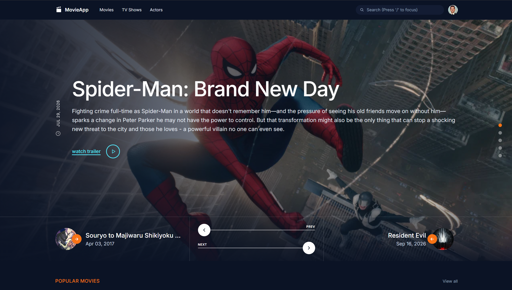

# Laravel Movie App 🎬

A movie browsing application built with **Laravel 13** and the **TMDB (The Movie Database) API**. The application fetches movie information from TMDB and displays it through a user-friendly interface.

## 📸 Screenshots

### Home Page



## ✨ Features

- Browse popular movies.
- Explore movies by genre.
- View movie details and information.
- Fetch movie data from the TMDB API.
- Responsive user interface.
- Built with Laravel 13.

*Features may vary depending on the current implementation.*

## 🛠️ Technologies Used

- **Backend:** Laravel 13
- **Language:** PHP 8.3 or later
- **Movie Data:** TMDB API
- **Dependency Management:** Composer
- **Frontend Assets:** Node.js and npm, if required by the project
- **Database:** SQLite or MySQL, depending on your configuration

## 📋 Requirements

Before setting up the project, ensure you have the following installed:

| Requirement | Version |
|---|---|
| PHP | 8.3 or later |
| Composer | 2.x recommended |
| Laravel | 13.x |
| Node.js and npm | Required if the project uses Vite or npm-managed assets |
| Database | SQLite or MySQL, depending on your configuration |
| Git | Latest stable version recommended |

PHP 8.3 is the minimum version required by Laravel 13. Make sure the necessary PHP extensions are enabled, including Ctype, cURL, DOM, Fileinfo, Filter, Hash, Mbstring, OpenSSL, PDO, Session, Tokenizer, and XML, as applicable to your PHP installation.

Official documentation: [Laravel 13 Installation](https://laravel.com/docs/13.x/installation)

## 🚀 Installation and Setup

Follow these steps to run the project on your local machine.

### 1. Clone the repository

Open your terminal and run:

```bash
git clone <YOUR_REPOSITORY_URL>
```

Navigate to the project directory:

```bash
cd laravel-movie-app
```

Replace `<YOUR_REPOSITORY_URL>` with your actual GitHub repository URL.

### 2. Install PHP dependencies

Run Composer to install the required PHP packages:

```bash
composer install
```

### 3. Create the environment file

Copy the example environment file:

**Windows (Command Prompt):**

```cmd
copy .env.example .env
```

**macOS / Linux / Git Bash:**

```bash
cp .env.example .env
```

### 4. Generate the application key

Run the following command:

```bash
php artisan key:generate
```

This generates the application encryption key in your `.env` file.

### 5. Configure the TMDB API

This project uses the TMDB API to retrieve movie information. You need your own API credentials to access the movie data.

1. Visit [The Movie Database (TMDB)](https://www.themoviedb.org/).
2. Create an account or sign in.
3. Visit your account's API settings: [TMDB API Settings](https://www.themoviedb.org/settings/api).
4. Request API access and obtain the API key required by the project.

Add the appropriate credential to your `.env` file.

For example, if the application reads an environment variable named `TMDB_API_KEY`:

```env
TMDB_API_KEY=your_tmdb_api_key_here
```

**Important:** The environment variable name must match the one used in your Laravel configuration or application code. If your project uses `TMDB_API_TOKEN` or another variable, configure that name instead.

Never commit your actual API credentials or `.env` file to GitHub.

### 6. Configure the database

Choose the database configured for your project.

**Option A: SQLite**

If the application uses SQLite, create the database file if it does not already exist:

```bash
php -r "file_exists('database/database.sqlite') || touch('database/database.sqlite');"
```

Configure your `.env` file:

```env
DB_CONNECTION=sqlite
```

**Option B: MySQL**

Create a database in MySQL, then update your `.env` file:

```env
DB_CONNECTION=mysql
DB_HOST=127.0.0.1
DB_PORT=3306
DB_DATABASE=laravel_movie_app
DB_USERNAME=root
DB_PASSWORD=
```

Update the username and password according to your local MySQL configuration.

### 7. Run database migrations

If the project contains database migrations, execute:

```bash
php artisan migrate
```

If the application does not require a database, or uses a different database configuration, adjust this step accordingly.

### 8. Install frontend dependencies

If your project includes a `package.json` file, install the frontend dependencies:

```bash
npm install
```

Compile the frontend assets:

```bash
npm run build
```

During development, you can use:

```bash
npm run dev
```

Keep the Vite development server running in a separate terminal if your application requires it.

### 9. Start the Laravel development server

Run:

```bash
php artisan serve
```

Open the following URL in your browser:

http://127.0.0.1:8000

Your Laravel Movie App should now be running locally.

## 🔑 Environment Configuration

Your `.env` file contains local application settings and API credentials. A typical configuration may look like this:

```env
APP_NAME="Laravel Movie App"
APP_ENV=local
APP_DEBUG=true
APP_URL=http://127.0.0.1:8000

TMDB_API_KEY=your_tmdb_api_key_here

DB_CONNECTION=sqlite
```

Use the actual environment variables required by your project. The example above is illustrative; retain the other settings generated by Laravel and configure your database appropriately.

## 🎬 TMDB API Reminder

This project uses [TMDB](https://www.themoviedb.org/) as its movie data provider.

Before running the application, remember to:

- Obtain your own TMDB API credentials.
- Add the required credentials to your local `.env` file.
- Verify that the environment variable names match your application code.
- Keep your credentials private and never commit them to the repository.

TMDB provides the movie data and API services used by the application. Review its [API documentation](https://developer.themoviedb.org/docs) for endpoint details, usage policies, and attribution requirements.

If you use TMDB-provided data or images, follow the applicable TMDB attribution and branding guidelines.

## 🐛 Troubleshooting

**Composer dependency errors**

Check your PHP version and run:

```bash
php -v
composer --version
composer install
```

**Application key missing**

Run:

```bash
php artisan key:generate
```

**Database connection errors**

Verify your database settings in `.env`, confirm the database exists, and run migrations if required.

**Movie data is not loading**

Verify that your TMDB credentials are valid, the environment variable name is correct, and your machine has internet access. If you changed environment configuration and Laravel is using cached settings, run:

```bash
php artisan config:clear
```

**Frontend assets are missing**

If your project uses Vite, run:

```bash
npm install
npm run build
```

## 📁 Suggested Project Structure

```text
laravel-movie-app/
├── app/
├── bootstrap/
├── config/
├── database/
├── public/
├── resources/
├── routes/
├── screenshots/
│   ├── home-page.png
│   ├── movie-details.png
│   └── genre-movies.png
├── tests/
├── .env.example
├── .gitignore
├── artisan
├── composer.json
├── package.json
└── README.md
```

This is a typical Laravel project structure. Your actual folders and files may differ depending on your implementation.

## 📄 License

This project is intended for learning and development purposes. Add your preferred open-source license if you plan to distribute the code.

## 🙌 Acknowledgements

- [Laravel](https://laravel.com/) for the application framework.
- [The Movie Database (TMDB)](https://www.themoviedb.org/) for movie data and API services.

This product uses the TMDB API but is not endorsed or certified by TMDB.
